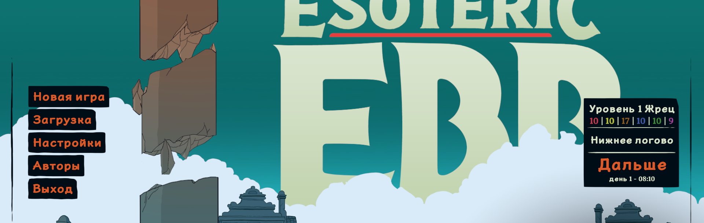
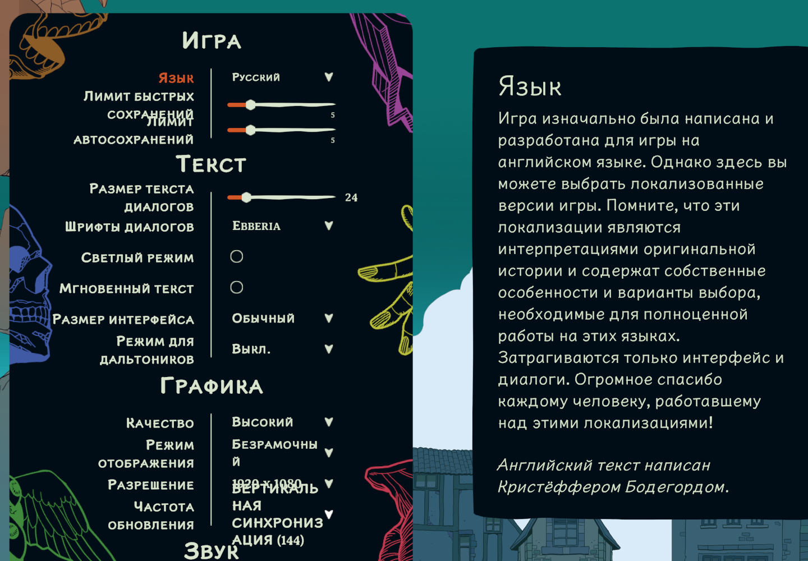
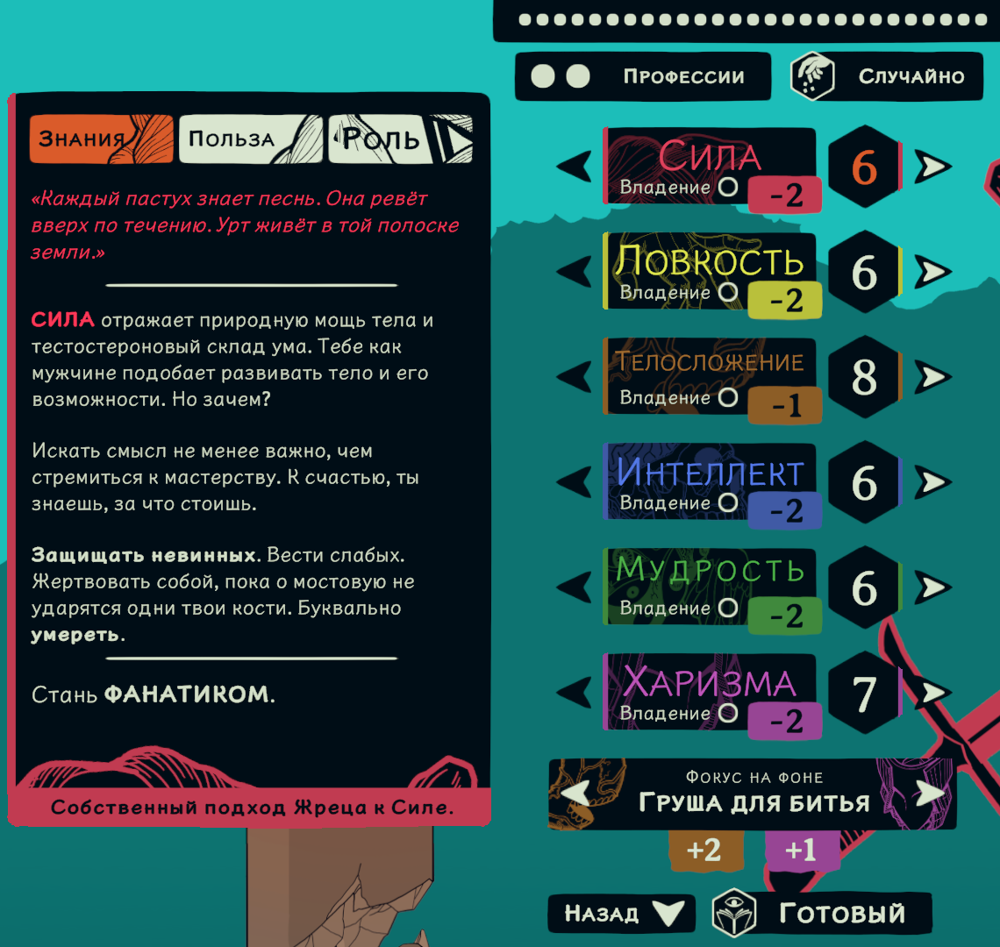
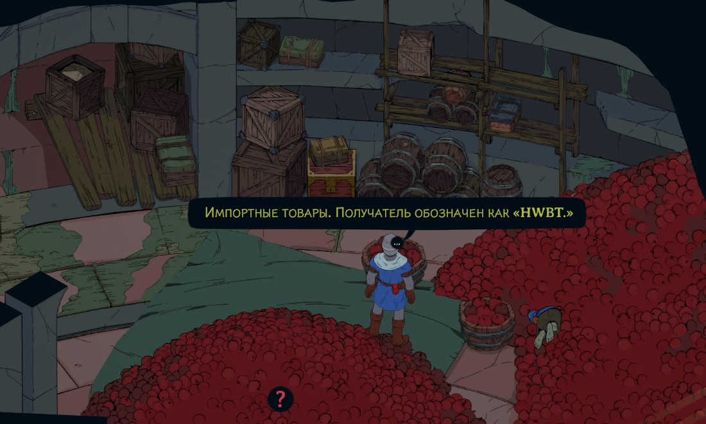

# Эбб

Полный русский перевод игры охватывает все непустые исходные строки — всего **81 891**
в 12 CSV-файлах (диалоги, лор, предметы, заклинания, интерфейс, кодекс).

## Скриншоты

| Главное меню | Настройки |
| :---: | :---: |
|  |  |

| Создание персонажа | Игровая сцена |
| :---: | :---: |
|  |  |

## Как это сделано

Игра (Unity 6 + IL2CPP, AppID 2057760) поставляет собственный пайплайн локализации:

```
Esoteric Ebb_Data\StreamingAssets\Localization\
├── Official\            ← оригинал (EN + CH) и эталон ключей
├── Template\            ← заготовка для новых языков (код F1)
├── ChineseCommunity\    ← пример перевода от сообщества (код CH)
└── Tools\               ← конвертер и Excel-справочник от разработчика
```

Разработчик прямо пишет в `_Localization_Guide.txt`: чтобы добавить свой язык, **скопируй папку
Template рядом с Official и заполни её**. Игра при старте читает папки и подгружает
пользовательские языки (в бинарнике это строки `[Official] CSV languagefiles` и
`[UserCreated] CSV languagefiles`).

Наш перевод лежит в папке `Russian\`; его код `RU`, как у китайского перевода `CH`.
Оригинальные файлы игры **не изменялись**, ничего не ломается при обновлении Steam.

## Установка

1. Скачайте [архив локализации v1.0.1](https://github.com/aa-blinov/esoteric-ebb-ru/releases/download/v1.0.1/esoteric-ebb-ru-v1.0.1.zip). В нём находится папка `Russian` с 12 CSV-файлами.
2. Найдите папку игры в Steam: **Manage → Browse local files**. Распакуйте `Russian` в `Esoteric Ebb_Data\StreamingAssets\Localization\` рядом с папками `Official` и `ChineseCommunity`.
3. Запустите игру → **Настройки → Язык → Русский** (в английском интерфейсе: **Options → Language → Русский**).

Переключение языка также работает горячими клавишами **V** / **B** прямо в игре,
а **Ctrl+R** перечитывает CSV без перезапуска.

Если язык не появился в списке, проверьте, что в первой строке всех 12 CSV стоит код `RU`
в последней колонке и что `MiscTexts.csv` содержит:

```csv
ID,Speaker,RU
LanguageDropdown,,Русский
FallbackLanguage,,EN
```

## Как переключить язык без меню

Файл настроек хранится в обычном JSON:

```
%USERPROFILE%\AppData\LocalLow\Christoffer Bodegard\Esoteric Ebb\SETTINGS.es3
```

в нём есть блок

```json
"LanguageCode" : { "__type" : "string", "value" : "EN" }
```

поставьте `"value" : "RU"`, и игра стартует сразу на русском.

## Как внести вклад

Перед правкой прочитайте [инструкцию для участников](CONTRIBUTING_RU.md),
[правила общения](CODE_OF_CONDUCT_RU.md) и [процесс релиза](docs/release-process.md).

## Шрифты

Кириллица в игре поддерживается штатно:

| Шрифт | Кириллица | Где |
|---|---|---|
| Noto Serif | да, 256 глифов | основной текст, диалоги |
| Liberation Sans | да, 256 глифов | fallback TMP |
| OpenDyslexic | да, 213 глифов | режим дислексии |
| LXGW WenKai | да, 156 глифов | китайский |
| Noto Serif <язык> | по 1 на каждый скрипт | тай, телугу, иврит, руны… |

В настройках есть **Text → Dialog Fonts**. Если русский текст в диалогах выглядит непривычно,
поставьте **EB Garamond**, **PT Serif**, **Roboto**, **Ubuntu** или **Open Dyslexic**: все они
полностью поддерживают кириллицу.

Два шрифта из списка кириллицы не имеют вовсе: **Ebberia** (он же шрифт названия игры) и
**Josefin Sans**. Игра не показывает вместо буквы «квадрат», а рисует руну, и русская строка в
таком шрифте превращается в ряд рун. Ebberia стоит первым в списке и является значением по
умолчанию, поэтому эту настройку стоит поправить сразу.

Установщик делает это сам: `scripts/install.py` смотрит в `SETTINGS.es3` и, если там стоит
 Ebberia или Josefin Sans, переводит настройку на Ubuntu.

## Что переведено

| Файл | Строк в CSV | Непустых строк EN | Пустых строк EN |
|---|---:|---:|---:|
| Dialogs.csv | 76 410 | 76 409 | 1 |
| MiscTexts.csv | 1 357 | 1 356 | 1 |
| EntityInfo.csv | 773 | 773 | 0 |
| QuestPoints.csv | 295 | 268 | 27 |
| SheetInfo.csv | 351 | 351 | 0 |
| ItemTexts.csv | 386 | 381 | 5 |
| UIElements.csv | 315 | 315 | 0 |
| Popups.csv | 247 | 247 | 0 |
| Glossary.csv | 2 173 | 1 490 | 683 |
| Feats.csv | 104 | 104 | 0 |
| SpellTexts.csv | 104 | 102 | 2 |
| NPCInfo.csv | 95 | 95 | 0 |
| **Итого** | **82 610** | **81 891** | **719** |

Переведены все непустые строки оригинала — всего **81 891**. Из 719 пустых строк оригинала
718 ячеек перевода тоже оставлены пустыми; единственное заполненное служебное поле —
`FallbackLanguage = EN`. Оно задаёт английский язык для строк без перевода, а не заменяет
непереведённые игровые реплики.

## Разметка

Вся игровая разметка перенесена символ в символ и проверена автоматически:

- `<i> <b> <u> <s>`: курсив, жирный, подчёркнутый, зачёркнутый
- `<shake> <wiggle>`: анимационные теги
- `<size=NN>`, `<color=#RRGGBB>`: размер и цвет
- `{0}`, `{CLERIC}`, `{ROGUE}`, `{WIZARD}`: игровые плейсхолдеры

Каждая строка проверяется: набор тегов в переводе должен совпадать с оригиналом.
Несогласованные строки отправляются на переделку.

## Терминология

Термины перевели и зафиксировали в глоссарии (1 853 записи). Его подходящие части
подставлялись в каждый пакет основного перевода, чтобы названия сущностей не расходились.
Ключевые решения:

| English | Русский |
|---|---|
| Cleric | Жрец |
| Urth / Urthfolk | Урт / Уртфолки |
| Norvik / Norvikian | Норвик / норвикий |
| Tolstad | Толстад |
| Freestrider | Фристрайдер |
| Azgalist | Азгалист |
| Coinlord | Владыка монет |
| Speak with Dead | Говорить с мёртвыми |
| Mage Hand | Магическая рука |
| Arcanist | Арканист |

## Про вёрстку: почему иногда налезали друг на друга

Ширина панели лора на экране создания персонажа фиксирована и равна **541 px**; полезная
ширина для текста составляет около 500 px. Русские слова длиннее английских, и в крупном кегле
(`<size=33…200>`) фразы переставали влезать, переносились и наезжали на соседний блок.

Замер по реальным метрикам игрового шрифта (0.70 em на заглавную):

| Строка | Кегль | Ширина | Панель |
|---|---|---|---|
| `EXTRA ITEMS` (EN) | 45 | 297 px | влезает |
| `ДОПОЛНИТЕЛЬНЫЕ ПРЕДМЕТЫ` (было) | 45 | **674 px** | перенос → наложение |
| `ЛИШНИЕ ПРЕДМЕТЫ` (стало) | 45 | 454 px | влезает |

Исправлено 4 строки:

| Ключ | Было | Стало |
|---|---|---|
| `AbilityScoreInfo_Strength_Uses1` | ДОПОЛНИТЕЛЬНЫЕ ПРЕДМЕТЫ | ЛИШНИЕ ПРЕДМЕТЫ |
| `AbilityScoreInfo_Dexterity_Uses2` | Как стремительный Разбойник | Как дерзкий разбойник |
| `AbilityScoreInfo_Constitution_Uses3` | Твоя политическая партия на прошлой неделе получила 2% голосов, и | Твоя партия набрала 2% голосов на прошлой неделе, и |
| `AbilityScoreInfo_Wisdom_Uses3` | `<size=73>Азгалианского` | `<size=62>Азгалианского` (кегль подогнан под ширину панели) |

Проверены все 32 строки с тегами `<size>`. Остальные строки переносятся и в
оригинале; это особенность дизайна, а не регрессия.

Дальше вёрстку чинили по экранам, каждый раз с замером в игре. Вот что нашлось и что
сделано:

| Экран | Что было | Что стало |
|---|---|---|
| Заставка игры | «Нажмите любую кнопку»: 778 px, надпись уходила под облако | кегль 36, ширина 517 px |
| Подсказки загрузки | 11 заголовков шире линейки в 499 px, вторая строка ложилась на текст | кегль уменьшен, слова сохранены |
| Лист персонажа | «Лимит быстрых сохранений» в две строки ложилась на следующую подпись | «Лимит быстрых» и «Лимит авто» |
| Тот же лист | «Очки здоровья», «Кубики здоровья», «Бонус мастерства» в две строки | «Очки», «Кубики», «Бонус» |
| Тот же лист | `[Пустой слот для умения]` перечёркивала линейки строк ниже | `[Пустой слот]` |
| Инвентарь | «Глубокое хранилище» рвалось посреди слова, вторая строка уезжала за кнопку | кегль 30 → 20 |
| Панель фона | «Эзотерический эксперт» ложился на строку с датой | «Эзотерик», «Писец революции», «Рекрут Уртгарда» |
| Карточка заклинаний | «Заклинания 1» впритык к «1», а счёт из двух цифр налезал бы | кегль подписей 20 → 16 |
| Подписи взаимодействий | «Вступить в бой» вылезала за плашку | «Говорить», «Взять» |
| Заметки сессии | линейка лежала на дате | кегль заголовка 38 |

Все замеры приведены в `docs/layout.md`.

## Проверка голоса

`scripts/scan_ai_patterns.py` читает все 81 892 строки перевода, ищет в них следы
машинного текста (паттерны навыка humanizer, переведённые на русский) и печатает строки
рядом с английским оригиналом, а также частоту связок и тире в обоих текстах. Английский
оригинал служит мерой: если слово есть и в источнике, перевод верен.

Последний прогон: 603 строки с паттерном. Каждую сверили с источником; все эти
обороты («очевидно», «время покажет», «иными словами», «вот в чём дело») есть и в
английском тексте игры. Русский не перегружен связками: частота «и это» 0.036 против 0.038
у источника, «очевидно» 0.062 против 0.076, «на самом деле» 0.052 против 0.125.

Тире: в английском источнике их 0.000 на 1000 знаков, в русском 1.489. Это почти столько же,
сколько в китайской локализации разработчика (1.48). Тире задают ритм русской фразы, поэтому
частота остаётся такой.

```bash
python3 scripts/scan_ai_patterns.py --verbose
```

## Известные проблемы

Две проблемы связаны с самой игрой и не решаются переводом.

- **Светлый режим опустошает одну панель.** Игра пересобирает часть интерфейса при
  переключении светлого режима на ходу, и пересобранные панели берут текст из собственных
  строк игры, а не из папки языка. Колонка примеров рядом с настройками уходит в английский;
  китайская сборка остаётся китайской, потому что разработчик положил туда свой китайский.
  Остальной интерфейс остаётся русским, а перезапуск снова читает локализацию.
- **Часть строк разработчика уже на русском.** Подсказка слота заклинания, экран, блокирующий
  сессию, и несколько подписей в настройках несут русский разработчика, а не перевод.

## Размер текста

Игра сама даёт настройку **«Размер текста диалогов»** (Options → Text → Dialog Text Size).
Разработчик рекомендует 24, но в оригинале английский текст короче русского, поэтому в переводе
пришлось уменьшить кегль.

В файле настроек:

```
%USERPROFILE%\AppData\LocalLow\Christoffer Bodegard\Esoteric Ebb\SETTINGS.es3
```

```json
"FontSize" : { "__type" : "int", "value" : 22 }
```

Сейчас там **22**, чуть меньше оригинала (разработчик рекомендует 24 для
английского), и ровно столько, сколько нужно, чтобы русский текст занимал в панелях столько же
места, сколько английский. Значение 20 тоже подходит и оставляет ещё больший запас.

Игра переписывает `SETTINGS.es3` при выходе и может вернуть своё значение в 24, поэтому
проверяйте настройку после закрытия игры. Поднять или опустить можно и самому:
**Options → Text → Размер текста диалогов**. Правая часть экрана показывает, как это
выглядит вживую.

Плюс к этому сделано три прохода по вёрстке:

1. **Крупные кегли** (`<size=33…200>`) в панели лора: четыре строки, в которых русский вариант
   был в 2,4 раза шире английского и переносился; кегли подогнали под ширину панели.
2. **Компактизация** 74 подписей экрана создания персонажа, где русский текст вышел длиннее
   оригинала; 23 из них переписаны компактнее (смысл и голос сохранены).
3. Остаток разницы, от 1,1 до 1,2 раза, компенсирует общее уменьшение кегля.

Соотношение «русский текст занимает столько же места, сколько английский» выдержано по всей
игре: в среднем русский вариант короче английского оригинала на величину от 5 до 10 процентов,
и там, где он длиннее,
это компенсировано кеглем.

## Если после обновления Steam перевод пропал

Обновление игры не трогает папку `Russian`; если она исчезла, просто скопируйте
её заново из этой сборки. Актуальная версия всегда лежит в папке проекта.

## Замечание про ветку Steam

У Esoteric Ebb в Steam есть бета-ветка **«Localization Branch»** (обновление 14 октября 2026).
Это сборка, в которой разработчик тестирует систему локализации. Если ваша копия игры
скачана с неё, всё описанное выше работает точно так же; если перевод вдруг не появился в
списке языков, проверьте, какая ветка активна в Steam → Свойства → Бета-версии.

## Как перевод сделан

Текст переводила модель MiniMax-M3 через локальный runtime, но не «одним куском».

### Шаг 1. Термины и имена
1. **Сначала термины.** 723 игровых термина из кодекса переведены отдельным проходом,
   затем отполированы (74 правки). Этот словарь задавал термины для остального текста.
2. **Потом имена.** 1 319 имён собственных (Норвик, Толстад, Урт, Фристрайдер, Азгалист…)
   отобраны эвристикой «слово встречается в середине предложения и не встречается строчными»,
   переведены и сгруппированы по корню, чтобы формы singular/plural не разъезжались.
   Итоговый глоссарий содержит 1 853 записи.
3. **Потом основной текст.** 81 891 строка батчами по ~3 200 символов, с подстановкой
   релевантной части глоссария в каждый батч. Батчи шли в контексте: соседние реплики
   одного диалога переводились вместе, поэтому характер говорящего не терялся.

### Шаг 2. Единый голос
Написал «голос перевода», кодекс из 9 пунктов: регистр, принцип повествования от второго лица,
правила прямой речи, запрет кальк и канцелярита, типографика, работа с глоссарием.
По нему прошёл **литературный редактор**:

| Проход | Что делал | Изменено |
|---|---|---|
| 1-й | вычитка по кодексу голоса, глоссарий в каждом батче | 6 062 строки |
| 2-й | то же, но контекстом служит уже вычитанный текст (голос распространяется по игре) | 1 728 строк |

Редактор работал в щадящем режиме: он меняет только то, что действительно нужно, и каждая правка
проходила проверку разметки и языка. Примеры правок:

- «Мёртвый man готов ответить» → «Мёртвый готов ответить»: ушёл английский хвост
- «Хватая крошечный резной нож» → «Ты хватаешь крошечный резной нож»: устранено висячее деепричастие
- «Она бросает вам понимающую улыбку» → «Она бросает тебе понимающую улыбку»: единое обращение
- «Спорно, ибо ты забрался в мою скромную хижину» → «Спорно, учитывая, что ты забрался в мою скромную хижину»

### Шаг 3. Единая типографика
Детерминированная нормализация по всему корпусу:

| Что | Было | Стало |
|---|---|---|
| прямые кавычки `"` | 43 264 | **0**, только «ёлочки» |
| троеточия `...` | 7 867 | **0**, только символ `…` |
| точка после закрывающей кавычки | 7 181 | **437** (остальные точки стоят внутри цитаты, по правилу) |
| «так же» вместо «также» | 88 | **0** |
| вложенные кавычки | «…«внутреннее».» | «…„внутреннее“.» |
| дефис вместо тире | 56 | **22** |

### Шаг 4. Один голос на всю игру
1. **Единое обращение.** В авторской речи, правилах и интерфейсе игра говорит с игроком
    на «ты». 233 строки приведены к единому виду. В диалогах персонажей «вы» осталось там,
   где это характер говорящего (например, демон к «людям»).
2. **Канонизация повторов.** 2 219 повторяющихся английских реплик были переведены
    по-разному в разных местах, что и разваливало повествование. Для каждой выбран один
   канонический вариант: **2 219 → 1** расхождение на 72 238 уникальных строк.
3. **Чистка языка.** 393 строки содержали английские вставки внутри русских предложений
    («тысячи лет old», «Кому вообще cares о полувеках?»); вычищено 323.
4. **Структурный QA.** 198 непарных кавычек сократили до 26 (остались реплики, разбитые на несколько
   строк, как в оригинале).

### Шаг 5. Контроль качества
У каждой строки сверяется мультимножество тегов и плейсхолдеров с оригиналом:
`<i> <b> <u> <s> <shake> <wiggle> <size=NN> <color=#RRGGBB>`, `{0}`, `{CLERIC}`.
Итог: **0 расхождений разметки, 0 пропущенных переводов для непустого оригинала, 0 дефектов смешанных шрифтов.**

Скорость: около 65 пакетов в минуту на 12 потоках; весь конвейер занимает около 4 часов.
Каждый вызов модели кэшируется на диске, поэтому пайплайн можно перезапустить в любой момент
без потери работы.
